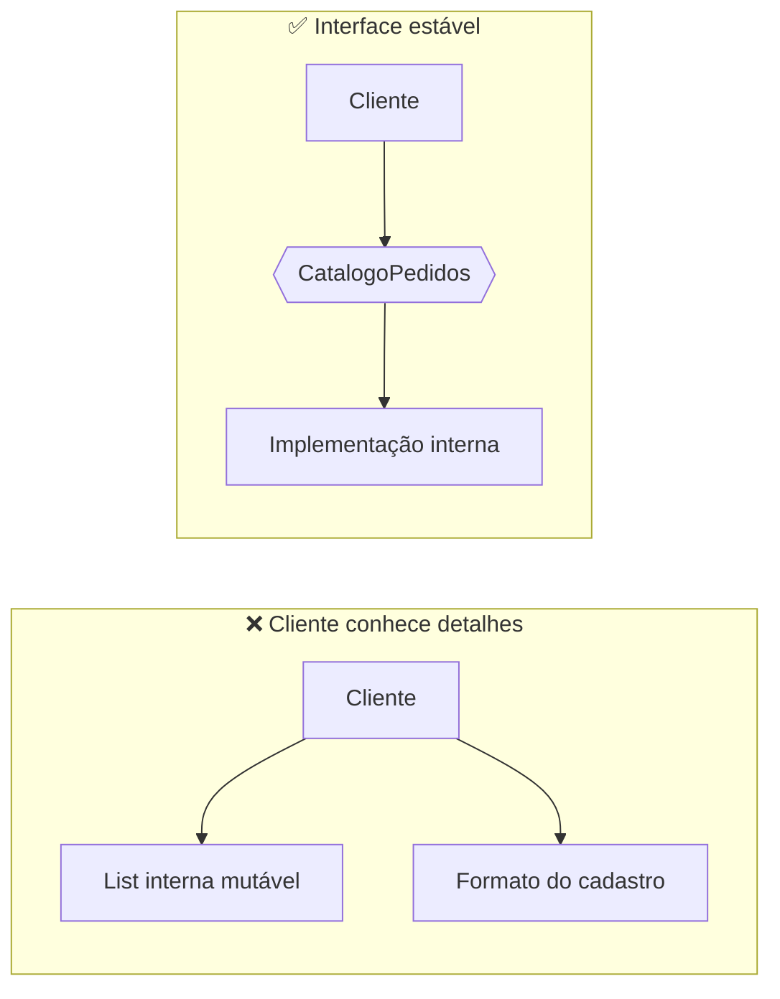

# 1. Modularidade

**Módulo** é uma unidade (classe, pacote, componente ou serviço) relativamente independente. A modularidade é uma questão de grau: separar arquivos por conveniência não basta; os limites devem reduzir o conhecimento necessário para entender, testar e alterar cada parte.

O critério de Parnas é o **ocultamento de informação**: cada módulo esconde uma decisão de projeto que pode mudar e oferece uma interface estável para seus clientes. Um módulo bem recortado responde “sim” às três perguntas:

1. Tem uma única razão principal para mudar?
2. Seus detalhes internos podem mudar sem obrigar clientes a mudar?
3. Sua responsabilidade pode ser descrita em uma frase?

## Antes × depois

**Antes:** clientes conhecem o formato interno do cadastro e alteram os dados diretamente.

```java
// Acoplamento ao detalhe interno: qualquer mudança na lista afeta os clientes.
List<String> pedidos = gerenciador.getPedidosInternos();
pedidos.add("pedido-42");
```

**Depois:** o módulo controla o estado e publica operações nomeadas.

```java
public interface CatalogoPedidos {
    void adicionar(String pedido);
    List<String> listar();
}
```

```java
public class CatalogoPedidosEmMemoria implements CatalogoPedidos {
    private final List<String> pedidos = new ArrayList<>();

    public void adicionar(String pedido) {
        pedidos.add(pedido);
    }

    public List<String> listar() {
        return List.copyOf(pedidos);
    }
}
```

O exemplo é adicional ao material dos slides. Na aplicação, `PedidoService` e `PedidoRepository` mostram o mesmo limite com injeção por construtor do Spring.



**Sintoma prático:** uma mudança em detalhes internos obriga módulos que só deveriam usar a funcionalidade a serem alterados ou retestados.

