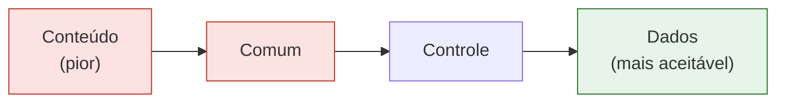
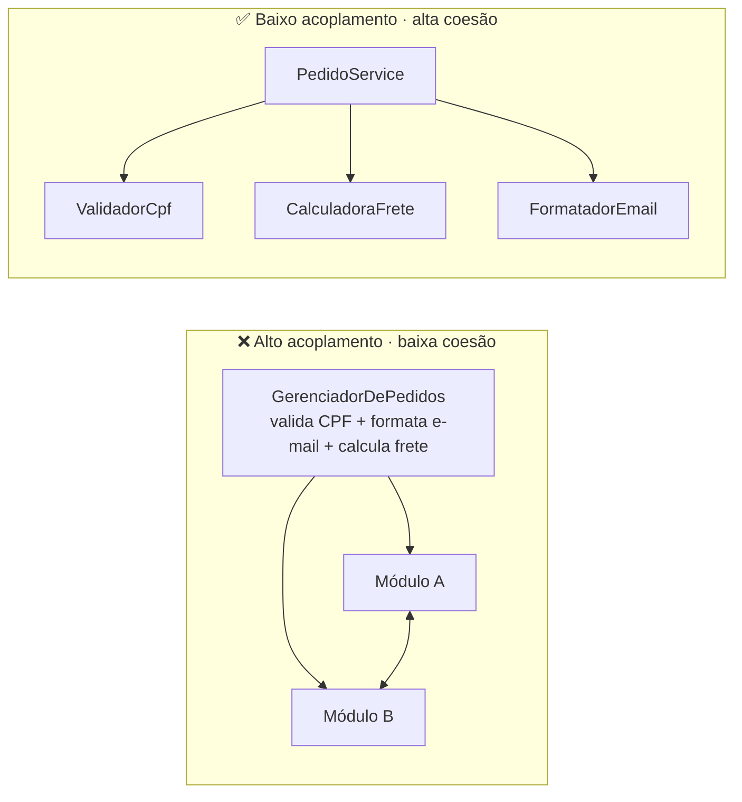

# 2. Acoplamento e coesão

**Acoplamento** é o quanto um módulo depende de outros. Do pior para o mais aceitável:

| Tipo | Quando ocorre | Exemplo |
|---|---|---|
| **Conteúdo** (pior) | Um módulo lê ou modifica os dados internos de outro. | Acessar diretamente um campo interno de outra classe. |
| **Comum** | Módulos compartilham estado global. | Vários serviços escrevem na mesma variável global. |
| **Controle** | Um módulo passa uma informação que decide o fluxo interno de outro. | `processar(pedido, modo=3)`. |
| **Dados** (mais aceitável) | São trocados apenas os dados necessários por parâmetros definidos. | `calcularFrete(endereco, peso)`. |

O objetivo não é eliminar toda dependência: é tornar explícitas e estáveis as necessárias. Uma interface pequena e dados necessários são mais fáceis de substituir e testar.

**Coesão** é o quanto os atributos e métodos de um módulo contribuem para um único propósito. `GerenciadorDePedidos` que valida CPF, formata e-mail e calcula frete tem baixa coesão. Separar essas responsabilidades tende a produzir alta coesão e baixo acoplamento.

## Antes × depois

**Antes:** parâmetros de controle escondem variações de comportamento:

```java
double calcular(double peso, String tipoEntrega) {
    if (tipoEntrega.equals("EXPRESSA")) return peso * 2.0;
    return peso * 1.0;
}
```

**Depois:** dependência explícita e dados necessários:

```java
interface CalculadoraFrete {
    double calcular(double peso);
}
```



### Checklist de diagnóstico

- [ ] Uma mudança em uma classe me obriga a retestar muitas classes sem relação aparente?
- [ ] Um bug corrigido cria outro em uma área que não deveria depender dele?
- [ ] É difícil descrever a classe em uma frase?
- [ ] Um módulo conhece ou modifica dados internos de outro?
- [ ] Há estado global compartilhado ou parâmetros usados só para controlar o fluxo?
- [ ] Posso substituir uma implementação sem alterar quem a utiliza?

Esses sintomas são mais úteis que perseguir uma métrica numérica isolada. A meta é **alta coesão e baixo acoplamento**.



