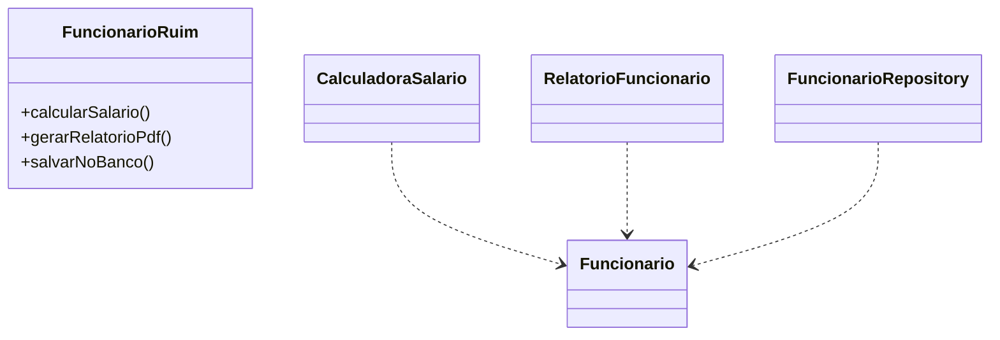
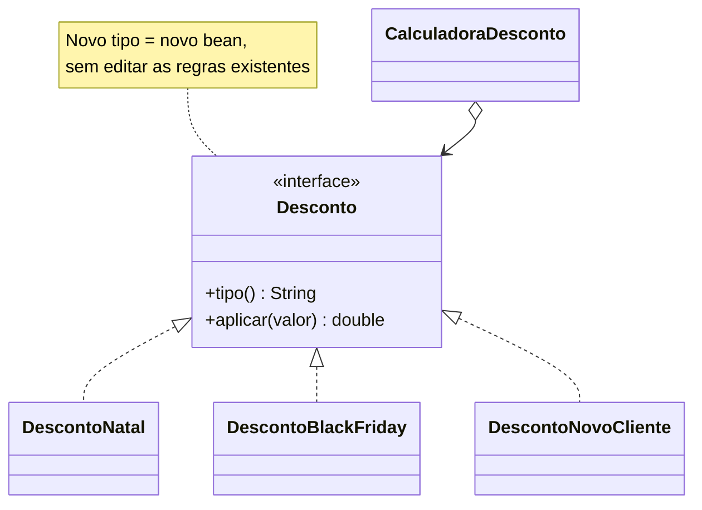
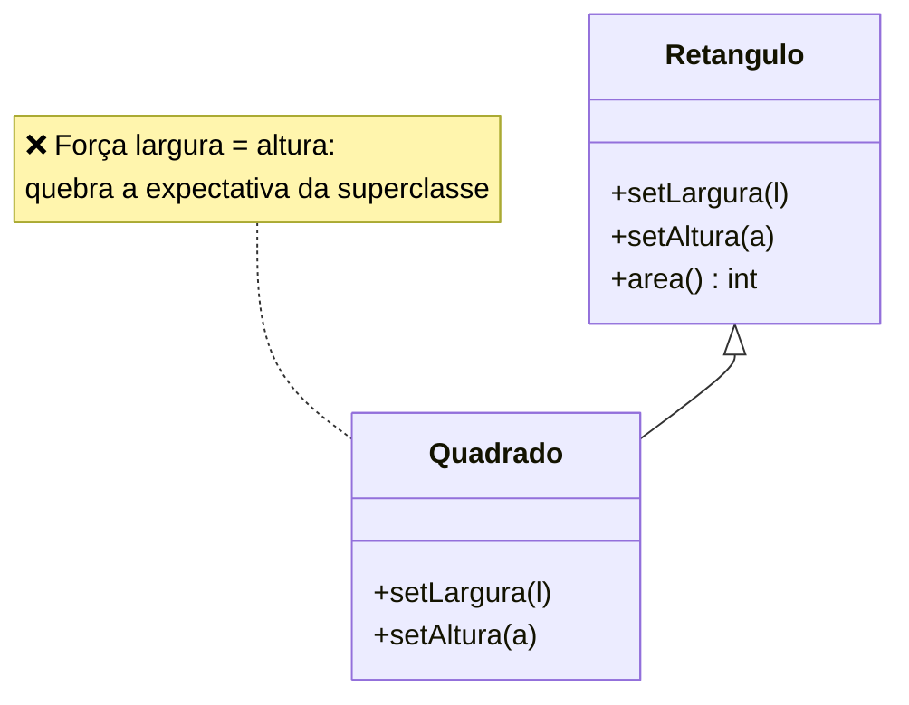
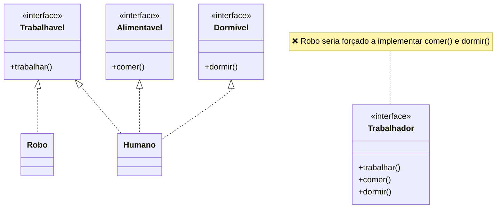
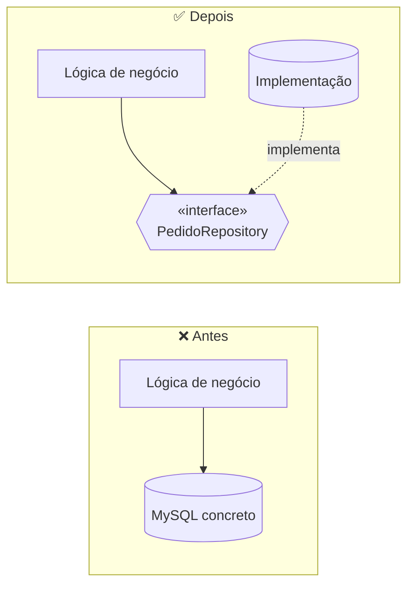

# 3. SOLID

SOLID é um acrônimo para cinco princípios de projeto. O termo foi cunhado por Michael Feathers a partir dos princípios sistematizados por Robert C. Martin. Os exemplos Java são adicionais; veja as implementações compiláveis em `src/main/java/br/edu/arquitetura/u2a1/`.

## SRP — responsabilidade única

**Uma classe deve ter um motivo para mudar**, associado a um ator/stakeholder.

**Antes:** `FuncionarioRuim` calcula salário, formata relatório PDF e persiste dados. Mudanças nas regras salariais, no formato do relatório e no armazenamento atingem a mesma classe.

```java
class FuncionarioRuim {
    double calcularSalario() { return salario; }
    String gerarRelatorioPdf() { return "PDF: " + nome; }
    String salvarNoBanco() { return "INSERT FUNCIONARIO " + nome; }
}
```

**Depois:** o dado do funcionário é separado de `CalculadoraSalario`, `RelatorioFuncionario` e `FuncionarioRepository`.

```java
record Funcionario(String nome, String cargo, double salario) {}
class CalculadoraSalario { double calcular(Funcionario f) { return f.salario(); } }
```



**Sintoma:** a mesma classe muda por solicitações de áreas diferentes.

## OCP — aberto/fechado

**Aberto para extensão e fechado para modificação.** Novas regras devem ser adicionadas sem editar condicionais centrais já estáveis.

**Antes:** `CalculadoraDescontoRuim` precisa ser editada a cada novo tipo.

```java
if (tipo.equals("NATAL")) return valor * 0.90;
if (tipo.equals("BLACK_FRIDAY")) return valor * 0.75;
return valor;
```

**Depois:** `CalculadoraDesconto` recebe uma `List<Desconto>` do Spring e indexa as estratégias pelo tipo. Cada regra é um bean `@Component`; um tipo novo é uma nova classe implementadora.

```java
interface Desconto {
    String tipo();
    double aplicar(double valor);
}
```



**Sintoma:** adicionar uma variação exige alterar e retestar um `switch` central.

## LSP — substituição de Liskov

**Subtipos devem ser substituíveis por seus tipos base sem quebrar a corretude.**

**Antes:** `Quadrado extends Retangulo` e força largura e altura a serem iguais. Um código que define 4 × 5 espera área 20, mas recebe 25.

```java
Retangulo forma = new Quadrado();
forma.setLargura(4);
forma.setAltura(5);
int area = forma.area(); // 25, embora o contrato do Retangulo sugira 20
```

**Depois (exemplo adicional):** `Retangulo` e `Quadrado` implementam `Forma`, sem relação de herança entre si.

```java
interface Forma { int area(); }
record Retangulo(int largura, int altura) implements Forma {
    public int area() { return largura * altura; }
}
```



**Sintoma:** o código precisa testar o subtipo ou evitar operações válidas no tipo base.

## ISP — segregação de interfaces

**Clientes não devem depender de métodos que não usam.**

**Antes:** uma interface ampla força robôs a implementar operações sem sentido:

```java
interface Trabalhador {
    void trabalhar();
    void comer();
    void dormir();
}
```

**Depois:** interfaces pequenas são compostas conforme a capacidade necessária. `Robo` implementa apenas `Trabalhavel`; `Humano` pode implementar também `Alimentavel` e `Dormivel`.

```java
interface Trabalhavel { void trabalhar(); }
interface Alimentavel { void comer(); }
interface Dormivel { void dormir(); }
```



**Sintoma:** implementações vazias, exceções de “não suportado” ou clientes que usam apenas parte de uma interface extensa.

## DIP — inversão de dependência

**Módulos de alto nível não dependem de módulos de baixo nível; ambos dependem de abstrações.** A lógica de negócio usa uma interface; Spring injeta a implementação por construtor.

**Antes:** o serviço instancia diretamente a classe MySQL.

```java
class PedidoServiceRuim {
    private final PedidoRepositoryMySql repository = new PedidoRepositoryMySql();
}
```

**Depois:** o serviço depende da interface `PedidoRepository`. A implementação pode ser substituída sem mudar a regra de negócio.

```java
@Service
class PedidoService {
    private final PedidoRepository repository;
    PedidoService(PedidoRepository repository) { this.repository = repository; }
}
```



**Sintoma:** testes ou troca de armazenamento exigem instanciar/conhecer detalhes de infraestrutura dentro da regra de negócio.

