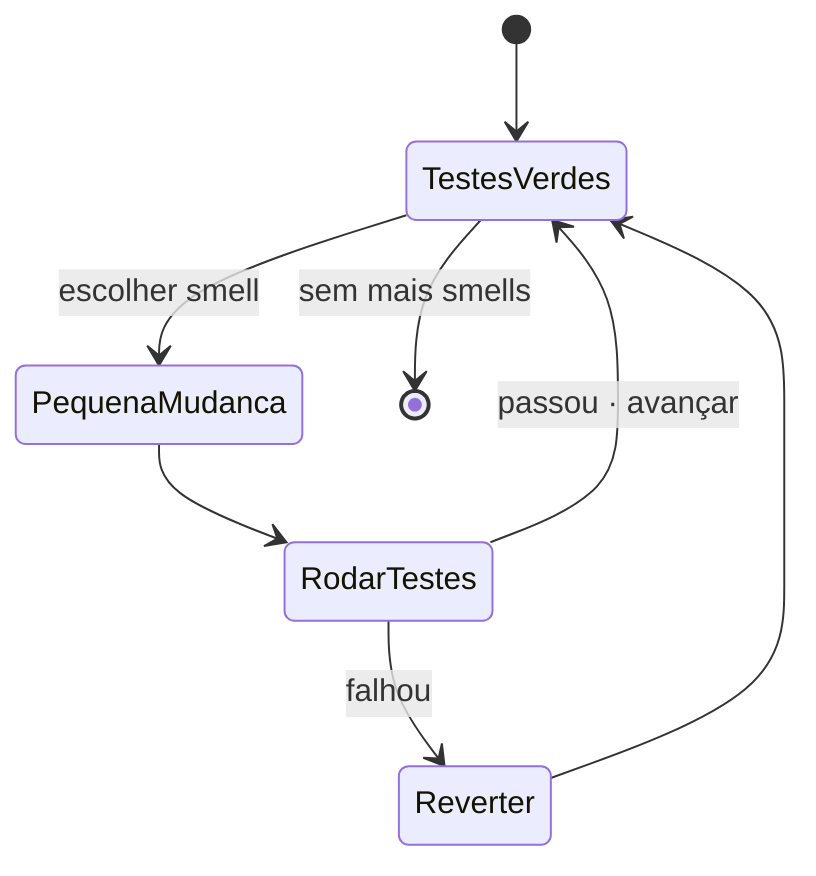
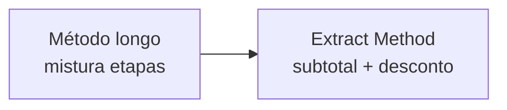
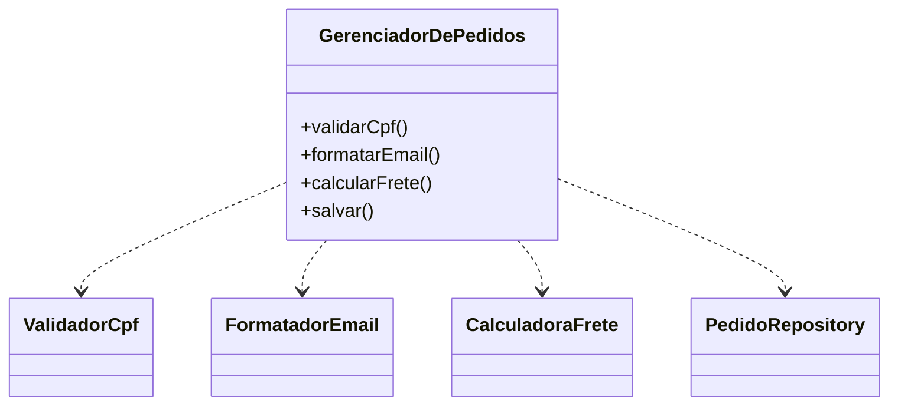
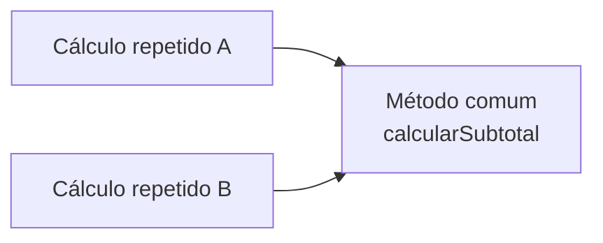
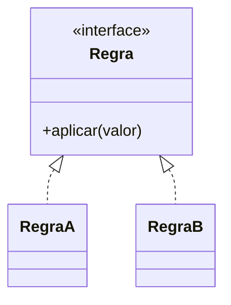
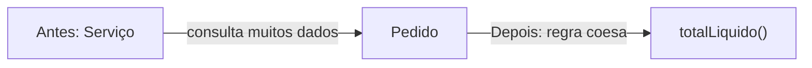
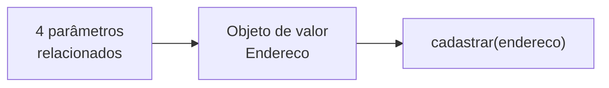

# 4. Refatoração e code smells

**Refatoração** (Martin Fowler) é mudar a estrutura interna sem alterar o comportamento observável. Faça mudanças pequenas e reversíveis, com testes automatizados verdes antes e depois de cada passo.



O teste em `src/test/java/br/edu/arquitetura/u2a1/refatoracao/RefatoracaoTest.java` compara a calculadora antes e depois para clientes VIP e comuns.

| Smell | Sintoma prático | Refatoração sugerida |
|---|---|---|
| Método longo | É difícil entender ou testar cada etapa isoladamente. | Extract Method |
| Classe grande | Uma classe muda por motivos de áreas diferentes. | Dividir responsabilidades (SRP) |
| Duplicação | A mesma regra precisa ser corrigida em mais de um lugar. | Extrair método ou abstração comum |
| Condicionais por tipo | Cada variação exige editar uma cadeia central de `if/else`. | Polimorfismo / Strategy |
| Feature envy | Um método consulta muitos dados de outro objeto. | Mover o método para a classe dos dados |
| Lista longa de parâmetros | Chamadas são difíceis de ler e parâmetros relacionados se confundem. | Criar objeto de valor |

## Smells: antes × depois

### Método longo → Extract Method

**Antes:**
```java
double total(double valor, int quantidade, double frete, boolean vip) {
    double subtotal = valor * quantidade;
    if (vip) subtotal *= 0.90;
    return subtotal + frete;
}
```

**Depois:** extraia `subtotal(...)` e `aplicarDesconto(...)`, preservando a sequência e o resultado, como em `CalculadoraPedido`.



### Classe grande → dividir responsabilidades (SRP)

**Antes:**
```java
class GerenciadorDePedidos {
    void validarCpf(String cpf) { /* validação */ }
    String formatarEmail(String email) { /* formatação */ return email; }
    double calcularFrete(double peso) { /* regra */ return peso; }
    void salvar(String pedido) { /* persistência */ }
}
```

**Depois:** `ValidadorCpf`, `FormatadorEmail`, `CalculadoraFrete` e `PedidoRepository`, com seus contratos próprios. Os exemplos de SRP e respectivos testes estão em `srp/`.

```java
class PedidoService {
    private final CalculadoraFrete frete;
    private final PedidoRepository pedidos;
}
```



### Duplicação → extrair método ou abstração comum

**Antes:**
```java
double totalA(double preco, int quantidade) { return preco * quantidade; }
double totalB(double preco, int quantidade) { return preco * quantidade; }
```

**Depois:**
```java
double calcularSubtotal(double preco, int quantidade) { return preco * quantidade; }
```



### Condicionais por tipo → polimorfismo / Strategy

**Antes:** `if (tipo == X) ... else if (tipo == Y) ...` cresce a cada variação.

**Depois:** implemente uma estratégia por tipo atrás de uma interface e injete as implementações; o exemplo OCP usa `List<Desconto>` do Spring.



### Feature envy → mover método para a classe dos dados

**Antes:** um serviço acessa repetidamente os dados de pedido para calcular seu total.

```java
double totalLiquido(Pedido pedido) {
    return pedido.itens().stream()
        .mapToDouble(item -> item.preco() * item.quantidade()).sum()
        - pedido.desconto();
}
```

**Depois:** mova a regra para `Pedido.totalLiquido()`, que já possui e protege os dados necessários.

```java
record Pedido(List<ItemPedido> itens, double desconto) {
    double totalLiquido() {
        return itens.stream().mapToDouble(ItemPedido::subtotal).sum() - desconto;
    }
}
```



### Lista longa de parâmetros → objeto de valor

**Antes:**
```java
void cadastrar(String rua, String numero, String cidade, String cep) { }
```

**Depois:**
```java
record Endereco(String rua, String numero, String cidade, String cep) {}
void cadastrar(Endereco endereco) { }
```

Os testes de subtotal, cálculo do pedido e endereço comparam os resultados antes/depois em `RefatoracaoTest`.



### Ciclo seguro

1. Confirme que os testes existentes estão verdes.
2. Escolha um smell e faça uma alteração pequena.
3. Rode os testes imediatamente.
4. Se falhar, reverta o passo; se passar, mantenha e prossiga.
