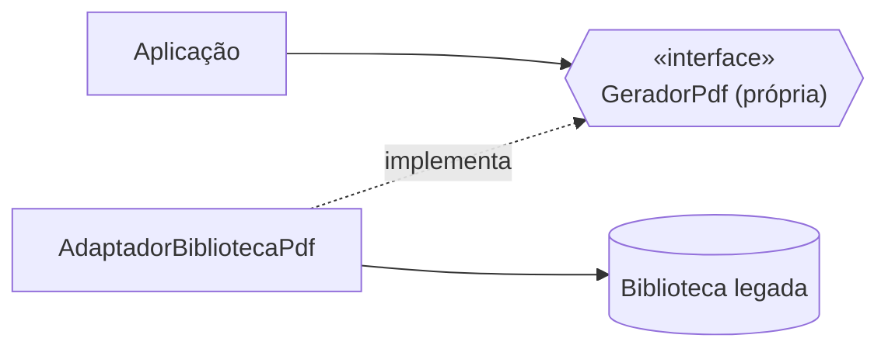

# 5. Reuso responsável

Há diferentes granularidades de reuso: função/classe no mesmo sistema, biblioteca de terceiros, framework e serviço exposto por API. Reusar reduz trabalho, mas também pode espalhar decisões e formatos de terceiros por todo o código.

## Antes × depois

**Antes:** regras de negócio chamam diretamente a API específica da biblioteca; se a biblioteca mudar, todos os clientes precisam mudar.

```java
byte[] pdf = biblioteca.createDocument(conteudo);
```

**Depois:** o domínio define sua interface (`GeradorPdf`) e um adaptador `@Component` traduz a interface para a API legada. `RelatorioService` depende da porta própria por construtor, usando DI do Spring.

```java
public interface GeradorPdf {
    byte[] gerar(String conteudo);
}
```

```java
@Component
public class AdaptadorBibliotecaPdf implements GeradorPdf {
    private final BibliotecaPdfLegada biblioteca = new BibliotecaPdfLegada();

    public byte[] gerar(String conteudo) {
        return biblioteca.createDocument(conteudo);
    }
}
```

`BibliotecaPdfLegada` é uma representação local didática da API de terceiros, não uma dependência real. O teste de `RelatorioService` prova que a porta segue funcionando por meio do adaptador.



**Sintoma prático:** nomes, tipos ou exceções de uma biblioteca aparecem espalhados pela regra de negócio, dificultando trocá-la ou testar o domínio.

**Exemplo adicional:** extrair uma abstração comum pode ser melhor que reaproveitar uma classe interna por conveniência, se essa classe acumula responsabilidades que não pertencem a ela. Interfaces próprias também alinham reuso responsável ao DIP.

