# Unidade 2 · Aula 1 — Modularidade, Coesão, Acoplamento, SOLID, Refatoração e Reuso

> **Curso:** Arquitetura de Sistemas e Microsserviços · **Unidade 2 · Aula 1** · Prof. Nataniel Paiva
> **Fonte:** `Aula1_..._Modularidade, Coesão, Acoplamento, SOLID, Refatoração e Reuso_unidade02_aula01.pptx` (40 slides)

Este README é um **briefing para outra IA** criar um projeto visual e didático sobre o conteúdo da aula. Tudo foi extraído dos slides; os diagramas Mermaid são **exemplos prontos** que renderizam no GitHub.

---

## 1. Objetivo do projeto a ser gerado

Um repositório em que cada conceito (modularidade, acoplamento/coesão, cada princípio SOLID, refatoração, code smells, reuso) tenha: **definição curta + exemplo "antes × depois" em código e em diagrama Mermaid + sintoma prático**. **Idioma:** PT-BR. **Tom:** didático.

### 1.1 Stack de código (obrigatória)

> **Todo código do projeto DEVE ser em Java com Spring.** Não gerar exemplos em outras linguagens. (Os slides não fixam linguagem; esta é a escolha do projeto.)

- **Java 21 (LTS)** + **Spring Boot 3.x** · **Maven** · **JUnit 5** + **Mockito** + `spring-boot-starter-test`.
- Pacote base sugerido: `br.edu.arquitetura.u2a1`, com subpacotes `srp`, `ocp`, `lsp`, `isp`, `dip`, `refatoracao`, `reuso` — cada um com versão `ruim` e `bom`.
- **DIP e injeção de dependência:** usar a **DI do Spring** (injeção por construtor, `@Service`, `@Repository`) como a técnica citada nos slides; mostrar a lógica de negócio dependendo de uma `interface` (ex.: `PedidoRepository`) e não da implementação (JPA/JDBC).
- **OCP:** substituir `if/else` por tipo por **beans que implementam a mesma interface**, injetados como `List<Desconto>` ou `Map<String, Desconto>` — novo tipo = nova classe `@Component`, sem editar as existentes.
- **Reuso responsável:** encapsular uma biblioteca de terceiros atrás de uma **interface própria**, com um `@Component` adaptador.
- **Refatoração:** todo "antes × depois" vem com **testes JUnit que passam antes e depois**.
- Evitar Lombok nos exemplos didáticos (para o código ficar explícito) — *decisão do projeto*.

## 2. Resumo do conteúdo (fonte de verdade)

### 2.1 Modularidade
- Divisão do sistema em **módulos** (classes, pacotes, componentes ou serviços) relativamente independentes; permite entender, desenvolver, testar e corrigir um módulo sem conhecer o sistema inteiro.
- **É questão de grau**, não binária: dividir por conveniência não basta.
- **Critério de Parnas — ocultamento de informação:** cada módulo encapsula uma decisão de projeto que provavelmente muda e expõe só uma **interface estável**.
- **3 perguntas** para validar um módulo: (1) uma única razão de mudança? (2) detalhes internos podem mudar sem alterar quem o usa? (3) nome e responsabilidade descritíveis em uma frase?

### 2.2 Acoplamento (do pior ao mais aceitável)
| Tipo | Quando ocorre |
|---|---|
| **Conteúdo** (pior) | um módulo acessa/modifica dados internos de outro (viola encapsulamento) |
| **Comum** | módulos compartilham área de dados global |
| **Controle** | um módulo envia informação que controla o fluxo interno de outro |
| **Dados** (melhor) | trocam apenas os dados necessários por parâmetros bem definidos |

### 2.3 Coesão
Quanto os atributos/métodos de um módulo se relacionam para **um único propósito**. Baixa coesão exemplo: `GerenciadorDePedidos` que também valida CPF, formata e-mails e calcula frete. **Alta coesão tende a gerar baixo acoplamento** → meta "alta coesão, baixo acoplamento".
**Sintomas práticos:** mexer em uma classe obriga re-testar dezenas de outras; corrigir um bug cria outro "sem relação"; difícil explicar a classe em uma frase. Sintomas > métricas numéricas.

### 2.4 SOLID (termo de Michael Feathers; princípios sistematizados por Robert C. Martin)
| Princípio | Ideia | Exemplo dos slides |
|---|---|---|
| **SRP** | uma classe, **um motivo para mudar** (um ator/stakeholder) | `Funcionario` que calcula salário + gera PDF + persiste viola o SRP |
| **OCP** | aberto para extensão, fechado para modificação | trocar `if tipo == X` por hierarquia com interface comum |
| **LSP** (Barbara Liskov) | subclasse substitui a superclasse sem quebrar a corretude | `Quadrado` herdando de `Retangulo` e forçando largura = altura |
| **ISP** | cliente não deve depender de métodos que não usa | dividir interfaces amplas em menores |
| **DIP** | alto nível não depende de baixo nível; ambos dependem de **abstrações** | lógica de negócio × banco via interface (injeção de dependência); base das arquiteturas em camadas, hexagonal e limpa |

### 2.5 Refatoração e code smells
- **Refatoração (Martin Fowler):** mudar a estrutura interna **sem alterar o comportamento externo**; exige **testes automatizados**; fazer em **passos pequenos e reversíveis**, rodando os testes a cada passo.
- **Smells:** método longo (→ *extract method*); classe grande (→ viola SRP); duplicação; cadeias de condicionais por tipo (→ polimorfismo); *feature envy*; lista longa de parâmetros (→ objeto de valor).
- **Refatoração → padrões:** condicionais → polimorfismo aproxima de **Strategy**; extrair interface para desacoplar aproxima de **Adapter**/DIP.

### 2.6 Reuso
- Granularidades: função/classe no mesmo sistema; biblioteca de terceiros; framework; serviço exposto por API.
- **Reuso responsável:** biblioteca mal encapsulada propaga decisões dela por todo o código → **encapsular atrás de interface própria** (alinhado ao DIP). Reaproveitar classe interna "por conveniência" gera acúmulo de responsabilidades → **extrair abstração comum**.

---

## 3. Exemplos Mermaid (renderizam no GitHub)

### 3.1 Visão geral dos conceitos

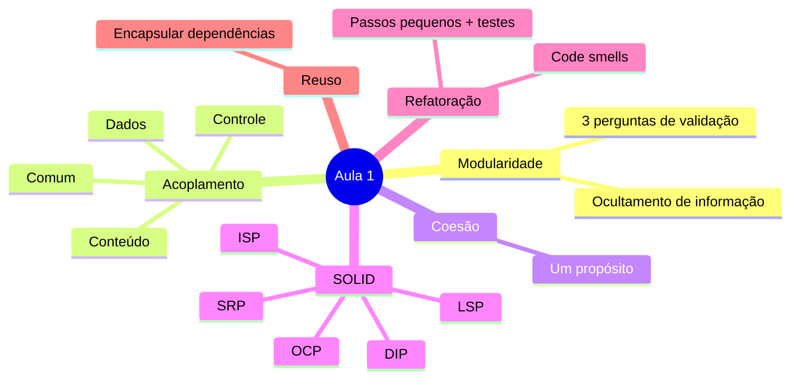

### 3.2 Espectro de acoplamento

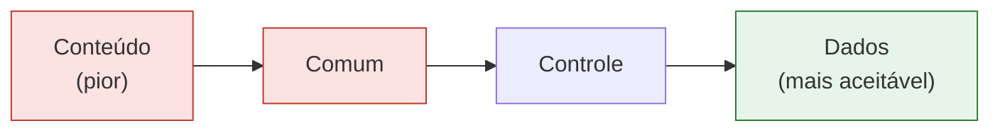

### 3.3 Alto acoplamento/baixa coesão × baixo acoplamento/alta coesão (Figura do slide 12)

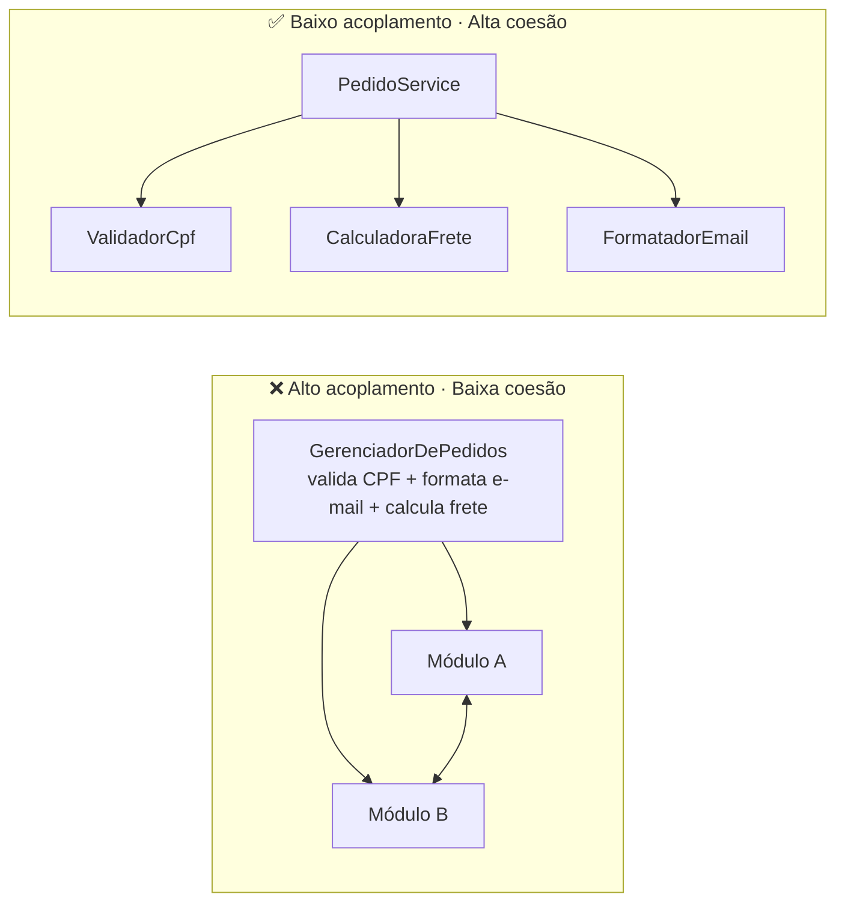

### 3.4 SRP — antes e depois

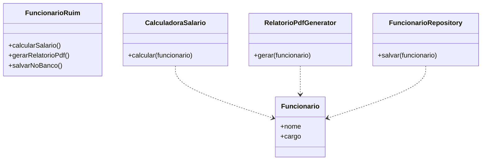

### 3.5 OCP — condicional → hierarquia

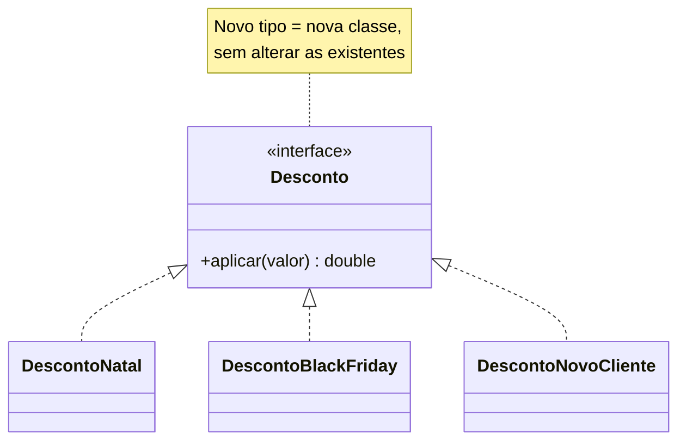

### 3.6 LSP — violação clássica

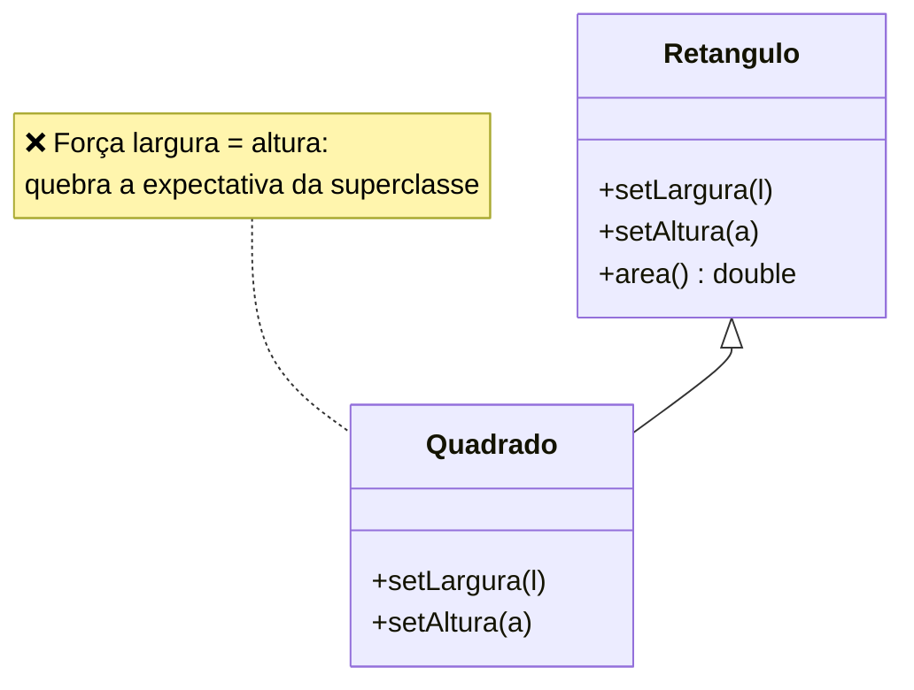

Correção sugerida (*exemplo adicional*): `Retangulo` e `Quadrado` implementam uma interface `Forma` com `area()`, sem herança entre si.

### 3.7 ISP — dividir interface ampla

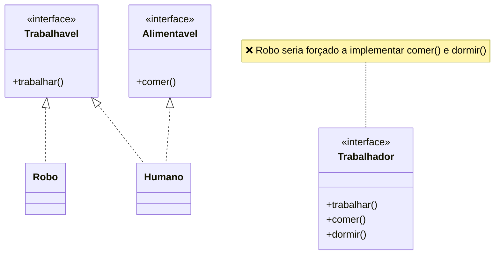

### 3.8 DIP — antes e depois (Figura do slide 27)

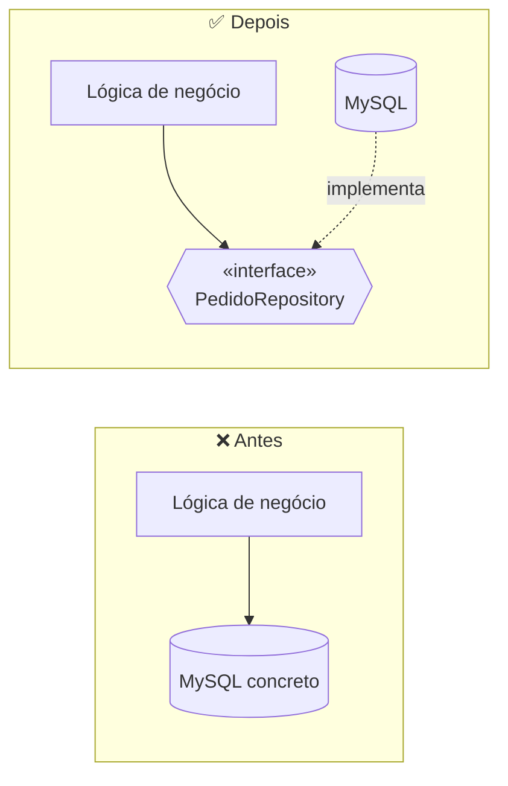

### 3.9 Ciclo de refatoração segura

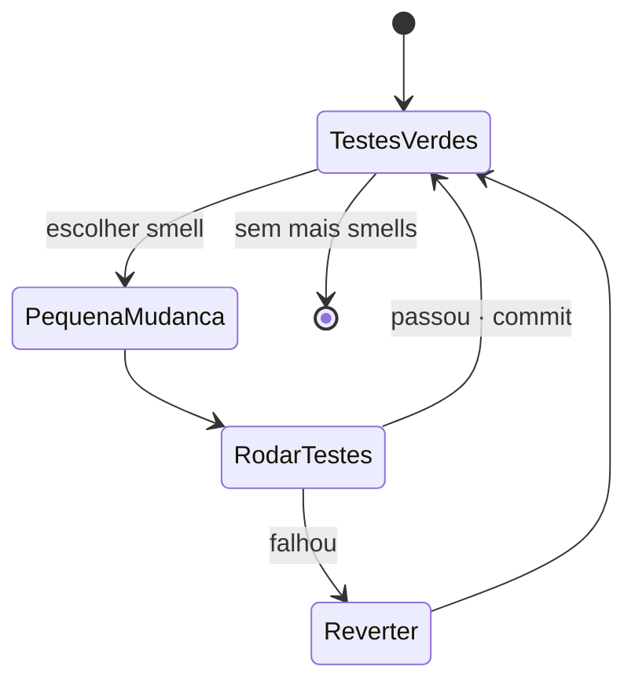

### 3.10 Smell → refatoração sugerida

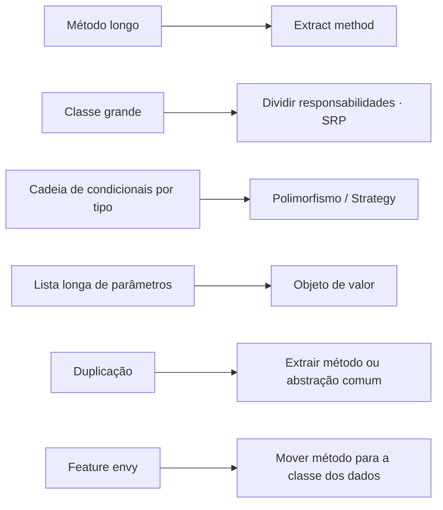

### 3.11 Reuso responsável — encapsular dependência externa

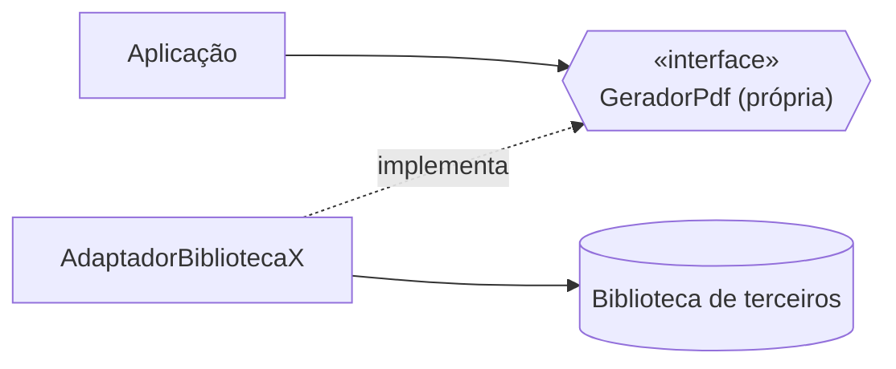

---

## 4. Estrutura sugerida do projeto a gerar

```
unidade2-aula1-projeto/
├── README.md
├── docs/
│   ├── 01-modularidade.md
│   ├── 02-acoplamento-e-coesao.md
│   ├── 03-solid.md                 # 1 seção por princípio, com antes/depois
│   ├── 04-refatoracao-e-smells.md
│   └── 05-reuso.md
├── diagramas/                      # .mmd fonte
├── exemplos/
│   └── solid/ srp/ ocp/ lsp/ isp/ dip/   # "ruim" e "bom" lado a lado, com testes
├── exercicios/                     # identificar smells e refatorar com testes
└── glossario.md
```

## 5. Regras para a IA que for gerar o projeto

1. **Antes × depois** em todo princípio e todo smell: código + diagrama.
2. **Todo exemplo de refatoração acompanha testes** que provam o comportamento preservado.
3. **Mermaid:** ```` ```mermaid ````; `classDiagram` para estrutura; `flowchart` para dependências; testar renderização.
4. Marque como *"exemplo adicional"* o que não está nos slides (linguagem, classes extras, correção do LSP).
5. Sintomas práticos (acoplamento/coesão) devem aparecer como **checklist de diagnóstico**.
6. Citar: *Unidade 2 · Aula 1 — Prof. Nataniel Paiva*.

## 6. Checklist de aceitação

- [ ] Os 4 tipos de acoplamento ordenados + definição de coesão
- [ ] Os 5 princípios SOLID com exemplo ruim × bom e diagrama
- [ ] Ciclo de refatoração segura (testes a cada passo)
- [ ] Tabela de smells → refatoração
- [ ] Exemplo de encapsulamento de biblioteca externa (DIP + reuso)
- [ ] Todos os diagramas renderizam no GitHub
